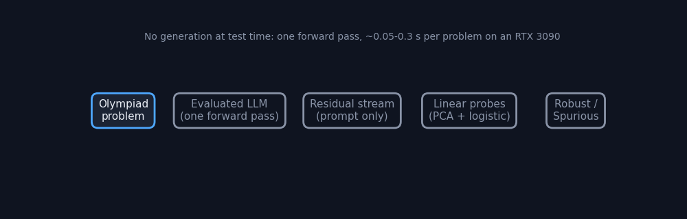

# Reading Robustness Before Reasoning

White-box residual-stream probes for the [AIMO Interpretability Challenge](https://aimo-interp.github.io/), Small Models Track.
One prompt-only forward pass per problem, three complementary linear probes, and plain-NumPy exported weights.

> **Current official entry:** the final corrected study and exact S2 bundle are
> maintained in [aimo-interp-residual-robustness-probes](https://github.com/Agnuxo1/aimo-interp-residual-robustness-probes).
> Archived official receipt **1015694** is Finished, accuracy **0.5714285714**
> on14public cases, coverage1.0 and invalid0. This repository preserves earlier
> supplementary implementation experiments. Its historical figures below
> predate a further CRLF/LF duplicate-group correction and are not the final
> leakage-corrected estimates. Do not select a new submission from them.

The corrected study retains positive signal (grouped AUROC0.812; nested
AUROC0.805), with a problem-bootstrap advantage over the surface control
+0.052 [0.002,0.104]. It also preserves non-significant contrasts with TF-IDF
and embeddings, and the negative causal-ablation result. The OpenReview report
is prepared; its submission receipt remains unverified. No duplicate Codabench
submission is created by this update.



## Applied improvement: training-only band normalization

The CV and ensemble implementations now fit the layer-band normalization **inside each training fold**. Validation rows cannot alter the fitted transform. The final submission exporter already saves normalization statistics fitted on the labelled training corpus; its inference path was correct and is retained.

A paired CPU experiment on real archived activations from all four models, 97 own-labelled rows, three seeds and five problem-grouped folds preserves the positive signal:

| Same folds and PCA in both arms | Mean AUROC | Mean accuracy |
|---|---:|---:|
| Previous all-row band transform | 0.832179 | 0.742268 |
| **Training-only transform** | **0.832035** | **0.742268** |

This preprocessing issue does **not** explain away the observed signal in this experiment. Seed-averaged probabilities have unchanged AUROC ranks (paired problem-bootstrap delta interval [0,0]); this does not establish identical probabilities or equivalence on unseen data. Randomized PCA is fixed in both arms and differs from the historical auto-solver grid; do not compare 0.832 directly against the earlier 0.825 as a performance improvement. The full 22-candidate grid has not been rerun with the corrected transform.

[Results and activation hashes](experiments/band_normalization_results.json) · [Paired OOF predictions](experiments/band_normalization_oof.csv) · [Implementation](src/band_normalization.py)

## Three stronger text-control experiments

All methods share problem-grouped folds; proxy training labels exclude problems with own-model labels. These are exploratory controls on real public labels, not new GPU inference.

| Intervention | Mean AUROC over three seeds |
|---|---:|
| Linear surface control | 0.718759 |
| I1: character n-grams | 0.737951 |
| I2: quadratic surface features | **0.761905** |
| I3: fixed probability hybrid | 0.731457 |

The quadratic control improves mean AUROC. Its paired difference on seed-averaged probabilities is +0.032345 with 95% problem-bootstrap interval [-0.021234,+0.085662], so superiority is not established. Averaging AUROCs and computing AUROC after averaging probabilities are different estimands. All outcomes are retained in [the results](experiments/text_controls_results.json).

## Existing official submission record

The existing project log records S1 as **Codabench 1015306, Finished, 8/14 (0.571), coverage 1.0, invalid 0**, following the always-true control 1015190 at 7/14. These 14 public cases are a contract check, not a reliable method ranking. This publication preserves the existing S1 artifacts and does not create another official submission. The score is transcribed from the project log; no fresh independent receipt was obtained during this publication.

Historical ensemble CV: AUROC 0.825±0.009, 5 seeds, 97 own-labelled rows. Selected among 22 configurations on the same data. Historical paired differences against surface controls are positive, but their 95% intervals include zero. Probes are correlational, not evidence of causal circuit use.

## Reproduce

```bash
bash scripts/setup_env.sh
bash scripts/download_data.sh
cd src
python build_dataset.py
bash ../scripts/run_extract.sh Qwen/Qwen3.5-4B deepseek-ai/DeepSeek-R1-0528-Qwen3-8B allenai/Olmo-3-7B-Think Skywork/Skywork-OR1-Math-7B
python cv_probe.py --seeds 5
python analysis.py --task ensembles
# Export the final train-fitted artifacts:
python export_probe.py --kinds last:band+mean:0.75+mean:1 --C 0.1 --out ../submission/probe_artifacts
cd ..
python scripts/stronger_text_controls.py --source src/data
# INPUT contains data/{labels.csv,problems.jsonl} and features/*.npz:
python scripts/compare_band_normalization.py --input INPUT --out experiments/new-band-run
python -m pytest tests -q
```

GPU extraction uses the official runtime-compatible environment; CPU reanalysis uses only the activation cache. Local workstation inference is not required. Data are fetched from their original sources under their own terms and are not redistributed here.

## Contents and limits

- `src/`: extraction, train-only CV, ensembles, dataset builder and export.
- `submission/`: S1 solution, feature extraction and derived NumPy probe weights.
- `experiments/`: historical log plus new raw predictions, metrics and hashes.
- `scripts/`: setup, data download and reproducible paired experiments.

97 own-model rows are unevenly distributed (Qwen12, DeepSeek64, OLMo9, Skywork12); 54 DeepSeek rows are MATH rather than olympiad-level. Proxy labels, configuration selection and known public labels limit generalization. No fresh hidden-test claim is made. An OpenReview paper receipt remains unverified.

Code: Apache-2.0. Author: Francisco Angulo de Lafuente. Models: Qwen, DeepSeek, Ai2 OLMo and Skywork. Official sources: [competition](https://aimo-interp.github.io/), [getting started](https://github.com/aimo-interp/getting-started), [baselines](https://github.com/aimo-interp/baselines). Prior work: [Discovering Latent Knowledge in Language Models Without Supervision](https://arxiv.org/abs/2212.03827); the present probes use labelled data and do not claim that method's unsupervised setting.
